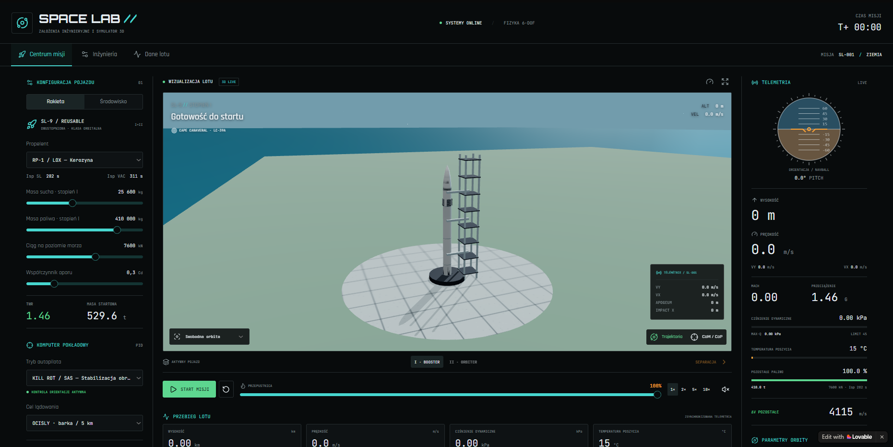

  <h3><strong>Live Demo: <a href="https://space-lab.lovable.app">space-lab.lovable.app</a></strong></h3>

# Space Lab 🚀

## About The Project

This project was created as part of a school workshop led by a representative from the **European Space Agency (ESA)**. The challenge was to create an interactive application or game about space with AI. 

I decided to build a **Rocket Flight Physics Simulator** (6-DOF) that visualizes telemetry, staging, and orbital mechanics in real-time. 

## Development Process

This project is a demonstration of **AI-driven Rapid Prototyping**. It was entirely built and iterated using **Lovable** to quickly bring a complex UI and physics concept to life. 

Instead of writing boilerplate code, I focused on:
* Systems design and application logic.
* Prompt engineering and iterative refinement.
* Tuning the physical parameters (TWR, drag, Isp) for realism.

## Features
* 🛰️ **Real-time Telemetry:** Velocity, altitude, dynamic pressure (Max-Q), and G-forces.
* 🚀 **Orbital Mechanics:** Staging (Booster / Orbiter separation) and trajectory visualization.
* 🎛️ **Flight Computer:** Autopilot modes (KILL ROT, SAS) and manual thrust control.

---
*Created as part of an ESA School Workshop challenge.*
